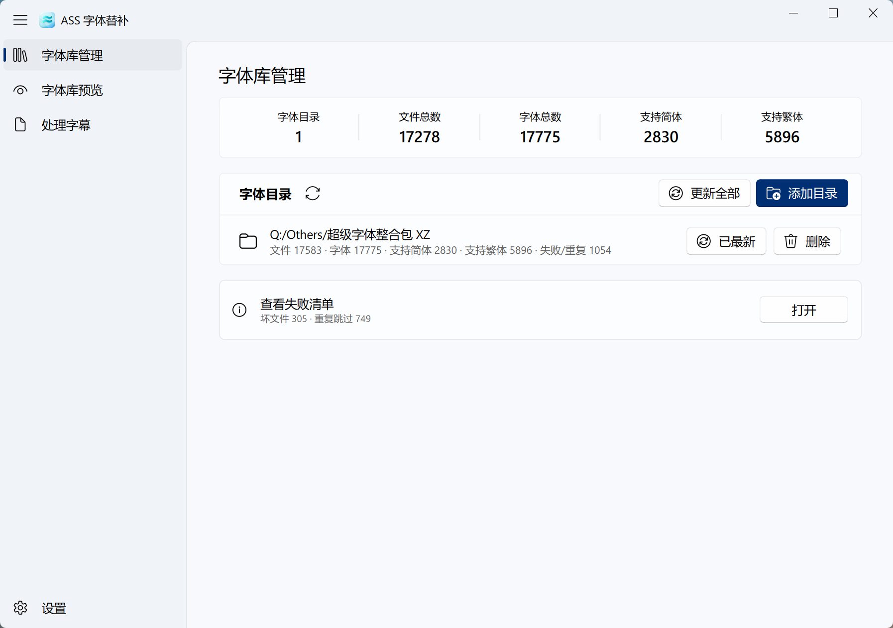
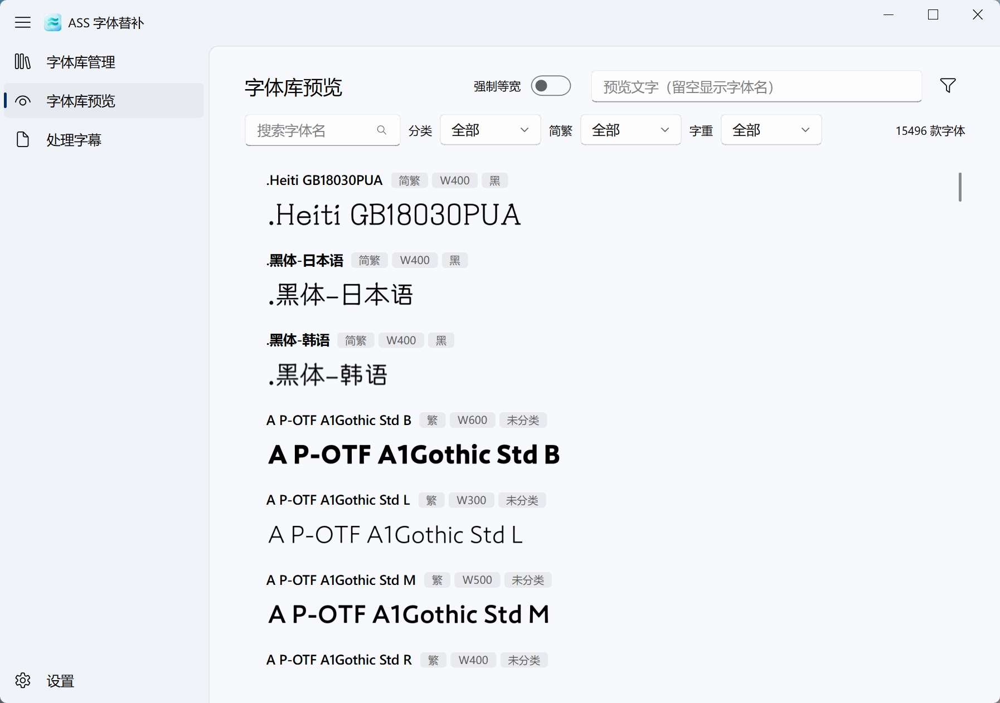
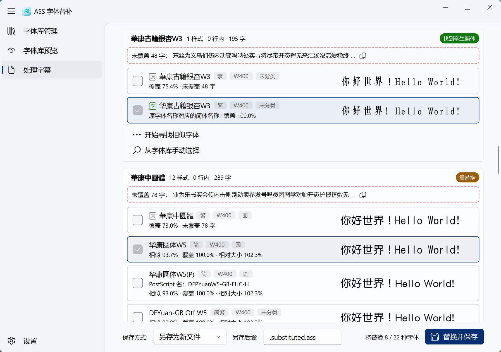
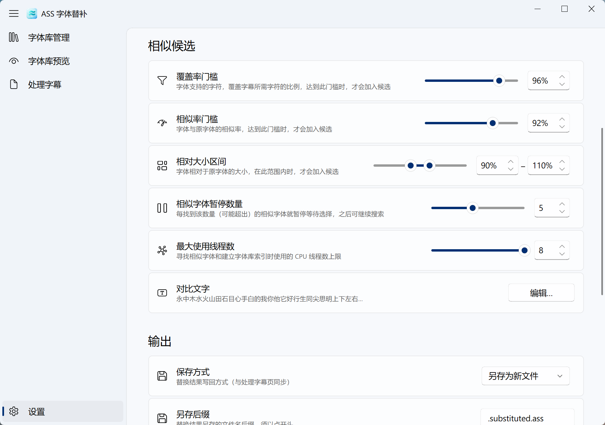

# ASS 字体替补

用于解决 ASS 字幕文件经简繁转换后，原字体覆盖率不足/难以确定相似替补字体等问题的一站式 GUI 工具

<div align=center>


</div>

## 下载

[前往 Release 下载](https://github.com/XiaofengdiZhu/AssFontSubstitute/releases)

> 当前只有 Windows 平台绿色版压缩包

## 功能特性 & 使用方法

- **字体库索引**：在字体库管理界面，添加任意多个字体目录以建立字体索引数据库，支持增量更新，字体格式支持 TTF、TTC、OTF
- **覆盖分析**：在处理字幕界面加载字幕文件后，本工具会自动分析每个字体对使用该字体的文字的覆盖率
- **孪生检测**：部分字体存在孪生的简体和繁体两个版本，例如“华康华综体W5”和“華康華綜體W5”，本工具可直接找到此类孪生对应字体
- **相似寻找**：点击“开始寻找相似字体”按钮来寻找相似且覆盖率达标的替补字体，结果会出现在候选字体列表中
- **候选预览**：原字体、候选字体并排预览，便于选择
- **一键替换**：选择好要替换为的字体后，最后点击“替换并保存”即可
- **替换记忆**：替换操作将被记忆，方便下次遇到相同字体时直接替换
- **双语界面**：简体/繁体中文 GUI 界面，Fluent Design 风格
- **绿色软件**：下载解压即用
- **性能优异**：多线程+缓存，就是快

## 截图









## 友情链接

- **[ass-hanvert](https://github.com/oborozuk1/ass-hanvert)**：简易 ASS 字幕简繁体转换工具
- **[FontLoaderSub](https://github.com/yzwduck/FontLoaderSub)**：ASS/SSA 字幕 OpenType 字体加载器

- **[GLM 5.3 Flash](https://z.ai/blog/glm-5.3-flash)**：本项目的代码完全由该 AI 模型编写

## 对于开发者

### 环境要求

- Windows 10/11（源码运行不依赖 Windows 专属能力，其他平台未验证）
- Python ≥ 3.12
- [uv](https://docs.astral.sh/uv/)

### 从源码运行

```bash
uv sync
uv run python -m ass_font_substitute.gui
```

### 开发

```bash
uv run pytest                 # 测试
uv run ruff check .           # 代码检查
uv run python scripts/gen_translations.py   # 界面文案变更后重跑翻译管线
```

### 打包 Windows 绿色版

```bash
scripts\build_portable.bat
```

产出 `deployment\main.dist\AssFontSubstitute.exe`（standalone 目录版）与 `deployment\AssFontSubstitute-<版本>-win64.7z`（不含用户数据 `Data/`，解压即用）。

## 许可证

本项目基于 [GPL-3.0](LICENSE.md) 发布——因界面使用 [QFluentWidgets](https://github.com/zhiyiYo/PyQt-Fluent-Widgets)（GPL-3.0）而有此要求。
